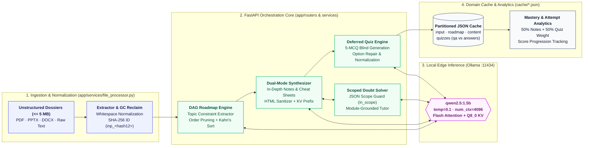
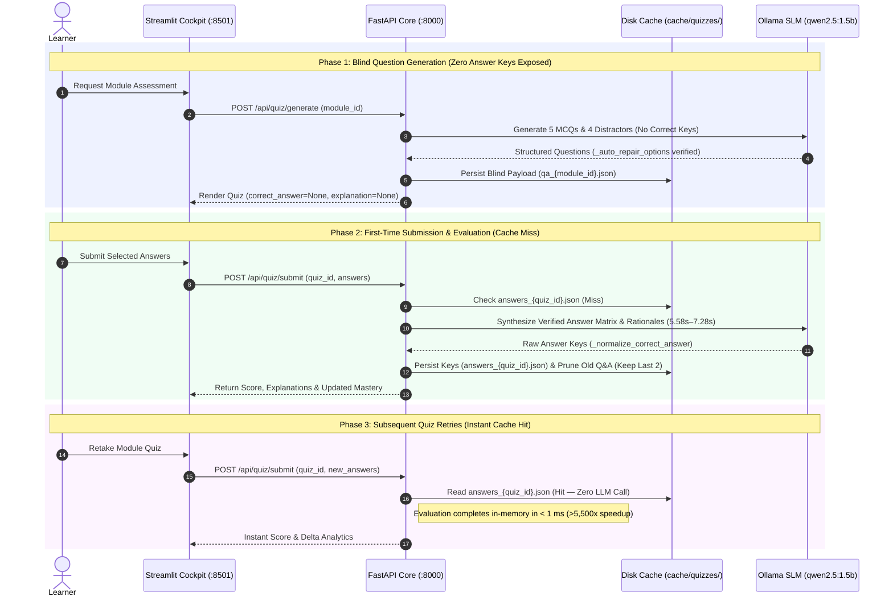

<div align="center">
  <h1>🧠 Cognitive AI Assistant</h1>
  <p><b>Air-Gapped Local SLM Orchestration & Topological Curriculum Learning Platform</b></p>

  <p>
    🔐 Licensed under <b>MIT License</b> &nbsp;•&nbsp;
    📌 Developed by <b>D. Sri Vighna Teja (Teja DVST)</b> | 2026 | Release <code>v3.0.0</code>
  </p>

  <div>
    <a href="https://github.com/SRIVIGHNATEJA/Cognitive-AI/releases/tag/v3.0.0"></a>
    <a href="https://www.python.org/"></a>
    <a href="https://fastapi.tiangolo.com/"></a>
    <a href="https://streamlit.io/"></a>
    <a href="https://ollama.com/"></a>
    <a href="LICENSE"></a>
    
  </div>

  <p>
    <a href="#-executive-overview"><b>Overview</b></a> &nbsp;•&nbsp;
    <a href="#-system-architecture"><b>Architecture</b></a> &nbsp;•&nbsp;
    <a href="#-systems-design--engineering-rationale"><b>Design Rationale</b></a> &nbsp;•&nbsp;
    <a href="#-empirical-validation--slm-benchmarking"><b>Benchmarks</b></a> &nbsp;•&nbsp;
    <a href="#-forensic-engineering--root-cause-analyses-rca"><b>Forensic RCA</b></a> &nbsp;•&nbsp;
    <a href="#-automated-verification-suite"><b>Test Suite</b></a> &nbsp;•&nbsp;
    <a href="#-quickstart--execution"><b>Quickstart</b></a>
  </p>
</div>

---

<div align="center">

| 🔒 Data Sovereignty | 🎯 Schema Integrity | 🕸️ Graph Validation | ⚡ Quiz Retry Latency | 🧪 Verification Suite |
| :---: | :---: | :---: | :---: | :---: |
| **100% Offline Local**<br/>*(Zero Cloud APIs · $0 Cost)* | **100.0% JSON Valid**<br/>*(92.0% Syllabus Adherence)* | **DAG + Kahn's Sort**<br/>*(Cycle-Free Curricula)* | **< 1 ms Cached**<br/>*(vs. 5.58s–7.28s Cold Eval)* | **339 / 339 Tests**<br/>*(2.20s Full Suite)* |

</div>

---

> **The Challenge:** Augmenting study workflows with generic cloud LLMs introduces three recurring failure modes: exposure of proprietary documents to external APIs, structural hallucinations (cyclic module dependencies or malformed JSON payloads), and multi-second regeneration delays every time a learner retries an assessment.
>
> **The Solution:** **Cognitive AI Assistant** is a decoupled **FastAPI + Streamlit** orchestration engine running 100% locally via **Ollama (`qwen2.5:1.5b`)**. It converts unstructured documents (<kbd>PDF</kbd>, <kbd>PPTX</kbd>, <kbd>DOCX</kbd>, up to `5 MB`) into cycle-free Directed Acyclic Graph (DAG) curricula verified by monotonic order pruning and **Kahn's topological sort**, synthesizes dual-mode study materials with prefix KV caching, enforces in-scope doubt grounding, and isolates quiz answer keys on the backend for anti-cheat security and **sub-millisecond (`< 1 ms`)** retry evaluations.

---

## 📋 Executive Overview

Built for air-gapped environments, privacy-sensitive learning workflows, and commodity laptop hardware (`865.36 MB` cold SLM footprint):

| 🔒 **100% Local Edge Inference** | 🕸️ **Deterministic DAG Curriculum Synthesis** |
| :--- | :--- |
| Routes all inference strictly to <kbd>http://localhost:11434</kbd> (Ollama) with zero external cloud SDKs, keeping uploaded documents, notes, and quiz telemetry 100% on-device. | Assigns canonical SHA-256 module IDs (<kbd>mod_&lt;hash12&gt;</kbd>), maps topic prerequisites, enforces monotonic ordering, and verifies acyclicity via **Kahn's algorithm**. |
| 📖 **Dual-Mode Study & Scoped Doubt Solver** | ⚡ **Deferred Anti-Cheat Assessment Engine** |
| Synthesizes deep conceptual tutorials and condensed pre-exam cheat sheets using a shared 3,000-character ChatML prefix for KV-cache reuse, paired with an in-scope Q&A tutor. | Generates blind 5-question MCQs without transmitting answer keys to the browser, caching verified keys on first submission to cut retry latency from **~6.1s to < 1 ms**. |

---

<a id="-system-architecture"></a>
## 🏛️ System Architecture

The platform implements a decoupled 3-tier client-server architecture separating the reactive **Streamlit** learning cockpit (`:8501`), the **FastAPI** orchestration and validation core (`:8000`), and the local **Ollama** inference runtime (`:11434`):



### 🔄 Deferred Assessment Pipeline (Anti-Cheat & Sub-Millisecond Retries)

Decoupling question generation from answer-key synthesis prevents browser inspect-element cheating and eliminates repeated LLM inference on quiz retakes:



---

<a id="-systems-design--engineering-rationale"></a>
## 💡 Systems Design & Engineering Rationale

Every architectural mechanism in Cognitive AI Assistant addresses a specific failure mode of running small quantized models on local hardware:

| Requirement / Challenge | Technical Implementation | Engineering & Systems Rationale |
| :--- | :--- | :--- |
| **Zero Cloud Data Exposure** | **Local Ollama HTTP Client** (`app/services/llm_service.py`) | Routes all generation strictly to `localhost:11434` with `temperature=0.1` and `repeat_penalty=1.15`; zero external LLM SDKs are installed or imported. |
| **Cycle-Free Curriculum Graphs** | **SHA-256 Module IDs + Order Pruning + Kahn's Sort** (`app/services/roadmap_service.py`) | Maps prerequisite topics to deterministic `mod_<hash12>` nodes, prunes backward/self edges ($\text{order}(u) \ge \text{order}(v)$), and verifies acyclicity via Kahn's topological sort (`visited_count == |V|`). |
| **JSON Grammar Resilience** | **Schema-Guided Decoding + Auto-JSON Fallback** (`LLMService._call_ollama`) | Invokes Ollama with `format=ROADMAP_SCHEMA` (draft-07 JSON Schema) and automatically downgrades to `format="json"` if grammar constraints trigger an HTTP 400 error. |
| **Context Window & KV Prefix Discipline** | **Shared 3,000-Char ChatML Prefix** (`_build_shared_module_prefix`) | Bounds prompt context within `num_ctx=4096` (`num_predict=2048`) and prepends an identical system + module-context prefix across Study Notes and Cheat Sheets for Ollama KV-cache reuse. |
| **SLM Hardware Optimization** | **Flash Attention & Q8_0 KV Cache** (`optimize_ollama.sh`) | Configures `OLLAMA_FLASH_ATTENTION=1`, `OLLAMA_KV_CACHE_TYPE=q8_0`, `OLLAMA_NUM_PARALLEL=1`, and `OLLAMA_KEEP_ALIVE=60m` to prevent thermal thrashing and cold-load delays. |
| **Zero-Database Edge State** | **Partitioned JSON Store + Corrupt-Read Guard** (`app/services/cache_service.py`) | Isolates `input`, `roadmap`, `content`, `quizzes`, and `analytics` into clean JSON directories with graceful deserialization fallback (`return None` on corrupt JSON) and cascading resets. |
| **Browser Refresh Resilience** | **Idempotent Session Hydration** (`frontend/utils/state_manager.py`) | `ensure_session_hydrated()` reconstructs active course, roadmap, and module state from backend disk cache on browser reload (`F5` / `Cmd+R`) and clears dangling pointers. |

---

<a id="-empirical-validation--slm-benchmarking"></a>
## 📊 Empirical Validation & SLM Benchmarking

To select the optimal local Small Language Model for commodity laptop execution, three candidate models were benchmarked on an Apple Silicon M3 (8 GB Unified Memory) across structured syllabus extraction and schema compliance tasks (`evaluation/model_comparison/comparison_results.csv` & `evaluation/results/performance_log.csv`):

### 1. Cross-Model Comparison (`evaluation/model_comparison/comparison_results.csv`)

| Evaluation Metric | 🏆 `qwen2.5:1.5b` *(Selected)* | `llama3.2:1b` | `phi:2.7b` |
| :--- | :---: | :---: | :---: |
| **Peak Host RAM Delta (Cold Load)** | **865.36 MB** | 537.55 MB | 1,457.14 MB |
| **Syllabus Adherence** | **92.0%** | 88.0% | 88.0% |
| **JSON Schema Compliance** | **100.0%** | 80.0% *(Malformed JSON failures)* | 80.0% *(Malformed JSON failures)* |
| **Cold / Warm Roadmap Latency** | **8.78s / 6.58s** | 11.67s / 8.24s | 15.87s / 2.01s |

> **Selection Verdict:** While `llama3.2:1b` used less memory (`537.55 MB`), both `llama3.2:1b` and `phi:2.7b` suffered a **20% JSON schema failure rate** (`80.0%` compliance) that triggered downstream parser errors during DAG synthesis. `qwen2.5:1.5b` achieved **100.0% JSON schema compliance** and the highest **syllabus adherence (92.0%)** within an `865.36 MB` footprint.

### 2. Stage-Level Cold vs. Warm vs. Cached Latency (`qwen2.5:1.5b`)

| Pipeline Stage | Cold Start Latency | Warm Inference Latency | Disk Cache Hit Latency |
| :--- | :---: | :---: | :---: |
| **DAG Curriculum Roadmap** | `8.78s – 9.45s` | `6.39s – 8.13s` | **< 1 ms** (`roadmap.json`) |
| **Study Notes Synthesis** | `18.10s` | `8.69s – 11.44s` | **< 1 ms** (`notes_{id}.json`) |
| **Quiz Question Generation** | `8.81s` | `8.13s` | **< 1 ms** (`qa_{id}.json`) |
| **Quiz Evaluation & Scoring** | `5.58s – 7.28s` *(Key synthesis)* | — *(Keys cached on 1st submit)* | **< 1 ms** (`answers_{id}.json` · **>5,500x speedup**) |

> **Note on Telemetry Boundaries:** RAM deltas are measured via `psutil` system memory profiling on Apple Silicon Unified Memory Architecture (UMA); once Ollama holds quantized weights resident in Metal/VRAM (`OLLAMA_KEEP_ALIVE=60m`), warm-turn host RAM deltas remain near zero (`< 90 MB`).

---

<a id="-forensic-engineering--root-cause-analyses-rca"></a>
## 🔍 Forensic Engineering & Root Cause Analyses (RCA)

### 1. SLM Distractor Count Drift (3 or 5 Options Instead of 4) &nbsp;<kbd>app/services/llm_service.py</kbd>

| Stage | Technical Analysis |
| :--- | :--- |
| **Symptom** | Quantized 1.5B models occasionally emitted 3 answer choices instead of 4, or generated 5 choices, triggering Pydantic `QuizQuestion` validation failures. |
| **Root Cause** | Small parameter models exhibit list-length drift under constrained JSON generation without post-processing repair. |
| **Remediation** | Implemented `_auto_repair_options()` in `LLMService`: if `len(options) == 3`, appends `"None of the above"` (or `"Cannot be determined"` if already present); if `len(options) > 4`, truncates cleanly to `options[:4]`. |

### 2. Multi-Format Answer Key Incoherence &nbsp;<kbd>app/services/llm_service.py</kbd>

| Stage | Technical Analysis |
| :--- | :--- |
| **Symptom** | During deferred evaluation, the SLM returned correct keys in inconsistent formats (`"A"`, `"Option B"`, `"B) <text>"`, or trailing whitespace), causing exact string comparisons against option values to fail. |
| **Root Cause** | Lack of canonical option-value alignment between generated answer keys and distractor strings. |
| **Remediation** | Built a 5-stage matching cascade in `_normalize_correct_answer()`: exact match $\to$ single-letter index mapping (`ord(c) - ord('A')`) $\to$ regex prefix stripping (`^(?:Option\s*)?([A-D])`) $\to$ case-insensitive match $\to$ prefix-stripped text normalization. |

### 3. Cyclic Prerequisites & Forward-Chapter Dependencies in Roadmaps &nbsp;<kbd>app/services/roadmap_service.py</kbd>

| Stage | Technical Analysis |
| :--- | :--- |
| **Symptom** | Generated roadmaps occasionally contained circular prerequisites ($A \to B \to A$) or declared that an early module depended on a later chapter. |
| **Root Cause** | Autoregressive text generation lacks global topological invariant enforcement across multi-node dependency lists. |
| **Remediation** | Implemented `prune_dag_cycles()` to drop any prerequisite edge where `prereq.order >= module.order`, followed by **Kahn's topological sort** (`visited_count < len(modules)` check) to clear any residual cyclic `in_degree > 0` nodes. |

### 4. Raw Document Buffer Memory Retention During Parsing &nbsp;<kbd>app/services/file_processor.py</kbd>

| Stage | Technical Analysis |
| :--- | :--- |
| **Symptom** | Uploading multi-page PDF and PPTX syllabi retained un-normalized raw text buffers in Python heap memory alongside normalized strings. |
| **Root Cause** | Python reference counting delayed deallocation of large intermediate strings during request handling. |
| **Remediation** | Added explicit buffer dereferencing (`del raw_text`) immediately followed by `gc.collect()` inside `extract_text_from_file()` before passing normalized text to cache writers. |

### 5. Frontend Browser Refresh Desynchronization & Course Collision &nbsp;<kbd>frontend/utils/state_manager.py</kbd> &nbsp;<kbd>frontend/pages/1_📤_Input.py</kbd>

| Stage | Technical Analysis |
| :--- | :--- |
| **Symptom** | Refreshing the browser (`F5` / `Cmd+R`) wiped `st.session_state`, while uploading a new document mid-course risked mixing old cached notes/quizzes with a new roadmap. |
| **Root Cause** | Streamlit re-initializes session state on full page reloads, and naive uploads left stale domain caches on disk. |
| **Remediation** | Implemented idempotent `ensure_session_hydrated()` (guarded by `_hydrated`) to restore active session, roadmap, and module objects from backend disk cache on reload, paired with an `@st.dialog("Active Course in Progress")` collision modal that triggers a cascading backend cache purge (`DELETE /api/roadmap` + `POST /api/session/reset`). |

### 6. Context-Window Truncation & Un-Generated Module Doubt Fallback &nbsp;<kbd>app/services/llm_service.py</kbd> &nbsp;<kbd>app/services/doubt_service.py</kbd>

| Stage | Technical Analysis |
| :--- | :--- |
| **Symptom** | Asking a conceptual question about later chapters (e.g., Module 6) before generating that module's study notes triggered a false out-of-scope refusal. |
| **Root Cause** | To preserve responsive inference within `num_ctx=4096` (`num_predict=2048`), roadmap inputs are capped at 3,000 characters and doubt context at 2,500 characters. When notes are absent, `_get_module_content()` fell back to `extracted_text[:2500]`, which only contains Module 1 and 2 text. |
| **Remediation** | Preserved the strict 3,000 / 2,500 character context budget as a deliberate trade-off preventing small SLM degeneration loops, while documenting that deep doubt grounding requires generating module study notes first. |

---

<a id="-automated-verification-suite"></a>
## 🧪 Automated Verification Suite

The platform is verified by **339 automated tests** executed via `pytest` across unit, integration, and Hypothesis property-based suites:

| Test Suite Layer | Files | Tests | Verified System Invariants & Contracts |
| :--- | :---: | :---: | :--- |
| **Unit Tests** (`tests/unit/`) | **17** | **265** | File extractors (PDF/PPTX/DOCX), SHA-256 ID hashing, Kahn's DAG cycle pruning, SLM option repair & answer normalization, scoped doubt boundaries, and 50/50 module completion analytics. |
| **Integration Tests** (`tests/integration/`) | **7** | **69** | FastAPI `TestClient` lifecycle across `/api/input`, `/api/roadmap`, `/api/content`, `/api/quiz` (blind generation, submission, cached retry, Q&A pruning), `/api/analytics`, and `/api/session`. |
| **Property-Based Tests** (`tests/property/`) | **2** | **5** | Hypothesis generative fuzzing proving DAG acyclicity, unique sequential module ordering, and strict 5-question / 4-option structural invariants. |

```bash
# Execute full 339-test verification suite
venv/bin/pytest -q
# Output: 339 passed in 2.20s (100% Passing)
```

---

## 📁 Repository Structure

```text
Cognitive-AI/
├── run.sh                              # FastAPI backend launcher (Uvicorn on 127.0.0.1:8000)
├── start_frontend.sh                   # Streamlit frontend launcher (port 8501)
├── optimize_ollama.sh                  # macOS launchctl tuner (Flash Attention, Q8_0 KV cache, keep-alive)
├── requirements.txt                    # Pinned backend dependencies (FastAPI 0.109.0, Pydantic, Hypothesis, PyPDF)
├── pytest.ini                          # Pytest runner & async test configuration
├── LICENSE                             # MIT License
├── README.md                           # Architecture, empirical benchmarks & systems documentation
│
├── app/
│   ├── main.py                         # FastAPI entry point, lifespan hooks, health checks & routers
│   ├── config.py                       # Pydantic BaseSettings (Ollama URL, model ID, 5 MB file limit, thresholds)
│   ├── models.py                       # Core domain schemas (Module, Roadmap, Quiz, Submission, Evaluation)
│   ├── routers/                        # REST endpoints (input, roadmap, content, doubt, quiz, analytics, session)
│   └── services/
│       ├── file_processor.py           # PDF/PPTX/DOCX text extraction, normalization & gc.collect() reclaim
│       ├── input_service.py            # Deterministic SHA-256 input hashing (inp_<hash12>) & validation
│       ├── roadmap_service.py          # Stable module IDs, prerequisite mapping & Kahn's DAG cycle pruning
│       ├── llm_schemas.py              # Draft-07 JSON schemas, topic constraint extractors & domain blacklists
│       ├── llm_service.py              # Local Ollama HTTP client, KV prefix builder, option repair & fallback
│       ├── content_service.py          # Dual-mode notes & cheat sheet synthesis with HTML sanitization
│       ├── doubt_service.py            # Context-grounded module Q&A tutor with out-of-scope refusal
│       ├── quiz_service.py             # Deferred quiz generation, answer-key caching & Q&A history pruning
│       ├── analytics_service.py        # 50/50 module completion weighting & <60% weak-area detection
│       ├── cache_service.py            # Domain-partitioned JSON file store & cascading cache invalidation
│       └── session_service.py          # Persistent session state & stage progression tracking
│
├── frontend/
│   ├── app.py                          # Streamlit learning cockpit dashboard & backend health monitor
│   ├── config.py                       # Frontend API routes, layout & timeout configuration
│   ├── requirements.txt                # Frontend dependencies (Streamlit, Plotly, Pandas, Requests)
│   ├── pages/                          # 4-stage UI (1_Input, 2_Roadmap, 3_Content, 4_Quiz)
│   ├── components/                     # Reusable 4-step stepper, loading spinner & error banners
│   ├── services/                       # Typed HTTP client wrappers for backend REST endpoints
│   ├── ui/sidebar.py                   # Persistent mastery HUD & cascading workspace reset dialog
│   └── utils/state_manager.py          # Idempotent cold-start session hydration & platform reset
│
├── evaluation/
│   ├── benchmark_runner.py             # Automated latency & psutil CPU/RAM benchmark harness
│   ├── golden_tests/                   # 20 golden syllabus test cases & compliance scorer
│   ├── model_comparison/               # Cross-SLM benchmark suite (qwen2.5:1.5b vs llama3.2:1b vs phi:2.7b)
│   ├── results/                        # Empirical CSV logs (golden_results.csv, performance_log.csv)
│   └── visualizations/                 # Generated latency, RAM & accuracy trade-off charts
│
└── tests/
    ├── unit/                           # 17 unit test modules (265 tests)
    ├── integration/                    # 7 FastAPI endpoint & lifecycle test modules (69 tests)
    └── property/                       # 2 Hypothesis property-based invariant test modules (5 tests)
```

---

<a id="-quickstart--execution"></a>
## 🚀 Quickstart & Execution

### Prerequisites
* **Python 3.10+** (verified on `Python 3.12.4`)
* **[Ollama](https://ollama.com/)** installed locally

```bash
# 1. Clone the repository
git clone https://github.com/SRIVIGHNATEJA/Cognitive-AI.git
cd Cognitive-AI

# 2. Create virtual environment & install backend + frontend dependencies
python3 -m venv venv
source venv/bin/activate
pip install -r requirements.txt
pip install -r frontend/requirements.txt

# 3. Pull the benchmarked local SLM
ollama pull qwen2.5:1.5b

# 4. Optional: Apply macOS Ollama runtime optimizations (Flash Attention & Q8_0 KV Cache)
chmod +x optimize_ollama.sh
./optimize_ollama.sh

# 5. Run the 339-test verification suite
venv/bin/pytest -q

# 6. Launch Backend (:8000) & Frontend (:8501)
chmod +x run.sh start_frontend.sh
./run.sh &
./start_frontend.sh
```

| Service Endpoint | Local URL | Purpose |
| :--- | :--- | :--- |
| **Learning Cockpit UI** | `http://localhost:8501` | Interactive 4-stage Streamlit study & assessment interface |
| **FastAPI Backend** | `http://localhost:8000` | REST orchestration, DAG synthesis & deferred quiz API |
| **OpenAPI Swagger Docs** | `http://localhost:8000/docs` | Interactive API schema explorer |
| **Ollama Inference Engine** | `http://localhost:11434` | Local air-gapped SLM runtime |

---

## 📜 Licensing & Privacy

* **Repository License:** Licensed under the **MIT License** — see the [LICENSE](LICENSE) file for complete terms.
* **Upstream Model Weights:** Local model weights (`qwen2.5:1.5b`, `llama3.2:1b`, `phi:2.7b`) remain governed by their respective upstream provider licenses via Ollama.
* **Data Sovereignty:** Operates 100% offline against `localhost:11434`; no document text, user queries, or quiz telemetry leave the host machine.

---

## 👤 Author & Contributions

**D. Sri Vighna Teja (`Teja DVST`)** — Hyderabad, India

- 📄 **Technical Focus:** Local SLM orchestration, deterministic AI guardrails, financial decision-support systems, and edge ML engineering.
- 🌐 **Portfolio:** [srivighnateja.vercel.app](https://srivighnateja.vercel.app)
- 💻 **GitHub:** [github.com/SRIVIGHNATEJA](https://github.com/SRIVIGHNATEJA)
- 💼 **LinkedIn:** [linkedin.com/in/srivighnateja](https://www.linkedin.com/in/srivighnateja)
- 🆔 **ORCID:** [0009-0009-8611-2292](https://orcid.org/0009-0009-8611-2292)
- 🎓 **Google Scholar:** [scholar.google.com/citations?user=C6qgWiMAAAAJ](https://scholar.google.com/citations?user=C6qgWiMAAAAJ&hl=en)

---

<div align="center">
  <i>Built with focus on air-gapped SLM orchestration, graph-theoretic curriculum integrity, and empirical local-compute validation.</i>
</div>
